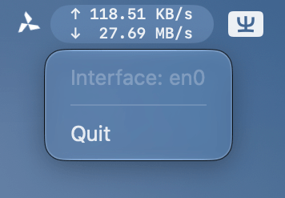

<p align="center">
  
</p>

# NetSpeedMonitorSwift

A minimal menu bar network speed monitor for macOS.

Heavily inspired by [elegracer/NetSpeedMonitor](https://github.com/elegracer/NetSpeedMonitor) and [byrencheema/airstats](https://github.com/byrencheema/airstats).

## Requirements

- macOS 26.0+
- Apple Silicon (ARM64)

## Installation

Download the app from [GitHub Releases](https://github.com/qvshuo/NetSpeedMonitorSwift/releases/latest), unzip it and move it to **Applications**.

If macOS blocks the first launch, remove the quarantine attribute:

```bash
xattr -dr com.apple.quarantine "/Applications/NetSpeedMonitorSwift.app"
```

## Build

Open `NetSpeedMonitorSwift.xcodeproj` in Xcode to build.

## Screenshot



## License

[MIT](LICENSE)
